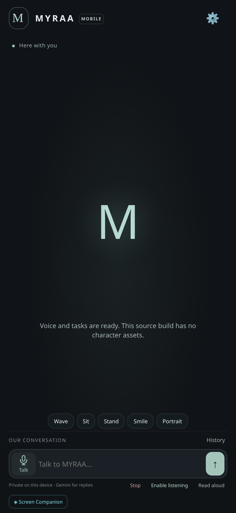
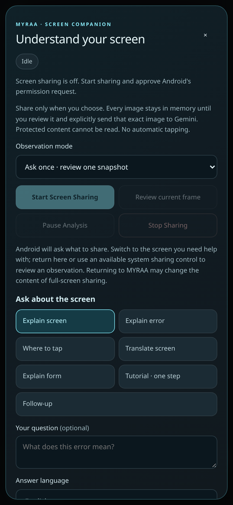
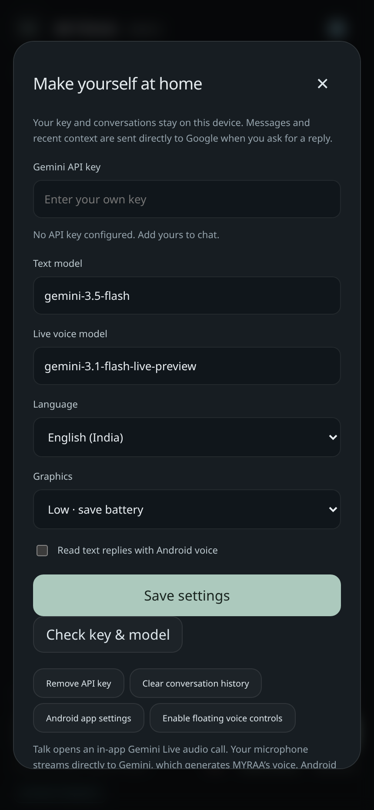

<div align="center">

# MYRAA

### Your AI companion. On your phone.

Voice conversations, everyday phone tasks, and screen guidance you choose to share.

**[↓ Download Android APK](https://github.com/ismailarainisc/Super-Intelligence-/raw/refs/heads/main/releases/rc8/MYRAA-Mobile-RC8-test.apk)** &nbsp; · &nbsp; **[Get the source](https://github.com/ismailarainisc/Super-Intelligence-/archive/refs/heads/main.zip)** &nbsp; · &nbsp; **[RC8 release](https://github.com/ismailarainisc/Super-Intelligence-/releases/tag/v1.0.0-rc.8)**

Android 8+ · Gemini · Java + TypeScript · Open source

</div>

<table>
<tr>
<td align="center" width="50%"><br><b>Meet MYRAA</b></td>
<td align="center" width="50%"><br><b>Understand your screen</b></td>
</tr>
</table>

<sub>Actual RC8 browser UI previews. This source build uses a neutral avatar; private 3D character assets are separate. [Preview details](docs/images/README.md)</sub>

### Talk. Get things done. Stay in control.

- **Natural voice** — Gemini Live conversations and optional “Hey MYRAA” listening.
- **Everyday tasks** — open apps, search, prepare WhatsApp drafts, and open Clock or Calendar setup.
- **Screen guidance** — ask about errors, translate text, or request the next step after reviewing a screenshot.
- **Your choice** — explicit sharing consent, per-image upload approval, and visible Stop controls.

### Try it in three steps

1. **[Download the test APK](https://github.com/ismailarainisc/Super-Intelligence-/raw/refs/heads/main/releases/rc8/MYRAA-Mobile-RC8-test.apk)** and install it on a compatible Android phone.
2. Open **Settings**, enter your own Gemini API key, select models available to your account, and tap **Check key & model**.
3. Tap **Talk**, type a task, or open **Screen Companion**. Review each screenshot before sending it to Gemini.

<details>
<summary>See the Settings screen</summary>



</details>

**RC8 is a test candidate.** Real-device capture and authenticated Gemini verification remain pending. OCR and direct Live video input are not included. [Verification & limitations →](docs/ANDROID-RC8-VERIFICATION.md)

<details>
<summary><b>Run from source</b></summary>

Install **Node.js/npm, JDK 21, Android SDK platform 35 and build-tools 35.0.0**. Windows also needs **PowerShell 7**.

```bash
git clone https://github.com/ismailarainisc/Super-Intelligence-.git
cd Super-Intelligence-
npm ci
```

**Linux / macOS**

```bash
export JAVA_HOME=/path/to/jdk-21
export ANDROID_HOME=/path/to/android-sdk
bash scripts/build-android.sh
```

APK: `artifacts/android/MYRAA-Mobile-1.0.0-rc.8-source-test.apk`

**Windows — PowerShell**

```powershell
$env:JAVA_HOME = 'C:\path\to\jdk-21'
$env:ANDROID_HOME = 'C:\path\to\android-sdk'
npm run build:android
```

APK: `artifacts/android/MYRAA-Mobile-1.0.0-rc.8-source-test.apk`

**Have the original RC5 APK?** [Restore its 3D avatar and icon locally](docs/RC5-AVATAR-RESTORATION.md), keeping the RC8 features. Restored owner builds produce a `private-restored.apk`.

**Browser UI preview**

```bash
npx vite --host 127.0.0.1 --port 5178
```

Open `http://127.0.0.1:5178/mobile.html`. Native voice, phone actions and screen capture require the Android app. Without private model assets, the browser-only preview may report missing character assets.

</details>

<details>
<summary><b>Updating an existing install · tests · project details</b></summary>

The downloadable APK is development-signed. To preserve data when updating a differently signed installation, rebuild with its **original signing identity**. Do not uninstall an existing MYRAA app just to install this test build.

```bash
npm test
bash scripts/test-android-native.sh
bash scripts/test-screen-companion.sh
```

The native test scripts require the SDK/JDK environment variables above. Browser checks use explicitly identified fixtures; screenshots are not proof of Android capture or Gemini connectivity.

[Verification report](docs/ANDROID-RC8-VERIFICATION.md) · [Downloads & checksums](releases/rc8) · [Android task guide](docs/ANDROID-RC6-TASKS.md) · [OCR status](docs/ANDROID-RC8-OCR.md)

</details>

<div align="center">

Bring your own Gemini key. Keep credentials and signing keys private.

[MIT source license](LICENSE) · [Third-party asset rights](THIRD-PARTY-NOTICES.md)

</div>
